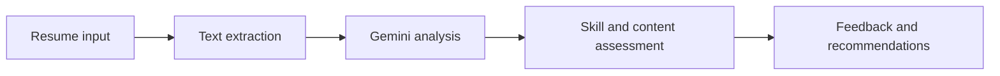

# 📄 Resume Analyzer with Gemini 1.5 Flash

## Project contribution

Gives job seekers AI-assisted feedback on resume content, skills, and presentation to support more focused improvements.

## Architecture



A powerful Resume Analyzer tool that uses **Google's Gemini 1.5 Flash** LLM to:
- Analyze resumes and job descriptions
- Score how well a resume matches a job
- Suggest missing skills and improvements
- Output Markdown-formatted feedback

🚀 Built with **FastAPI + Gemini API + PyPDF**

---

## 🔧 Features

- 📤 Upload resume (PDF)
- 📝 Paste job description
- 🧠 Get a match score (0–100%)
- 🧩 Get personalized suggestions
- ✨ Output in Markdown, rendered as HTML

---

## 📁 Folder Structure
resume-analyzer/

├── app.py # Main FastAPI server

├── prompts.py # Gemini prompt template

├── gradio_app.py # Interactive UI

├── utils.py # PDF text extractor

├── .env # Google Gemini API key

├── requirements.txt

└── README.md

---


## ⚙️ Setup Instructions

### 1. Clone the Repo

```bash
git clone https://github.com/AryaLolusare2712/resume-analyzer-gemini.git
cd resume-analyzer-gemini
```

---

2. Install Dependencies
```bash
pip install -r requirements.txt
```
If requirements.txt isn't provided, install manually:

```bash
pip install fastapi uvicorn python-multipart google-generativeai pypdf markdown python-dotenv
```

3. Set Up Environment Variables
Create a .env file:

```env
GOOGLE_API_KEY=your-gemini-api-key
```
You can get a Gemini API key here: https://makersuite.google.com/app

---

▶️ Run the App
```bash
uvicorn app:app --reload
```
Visit: http://localhost:8000

